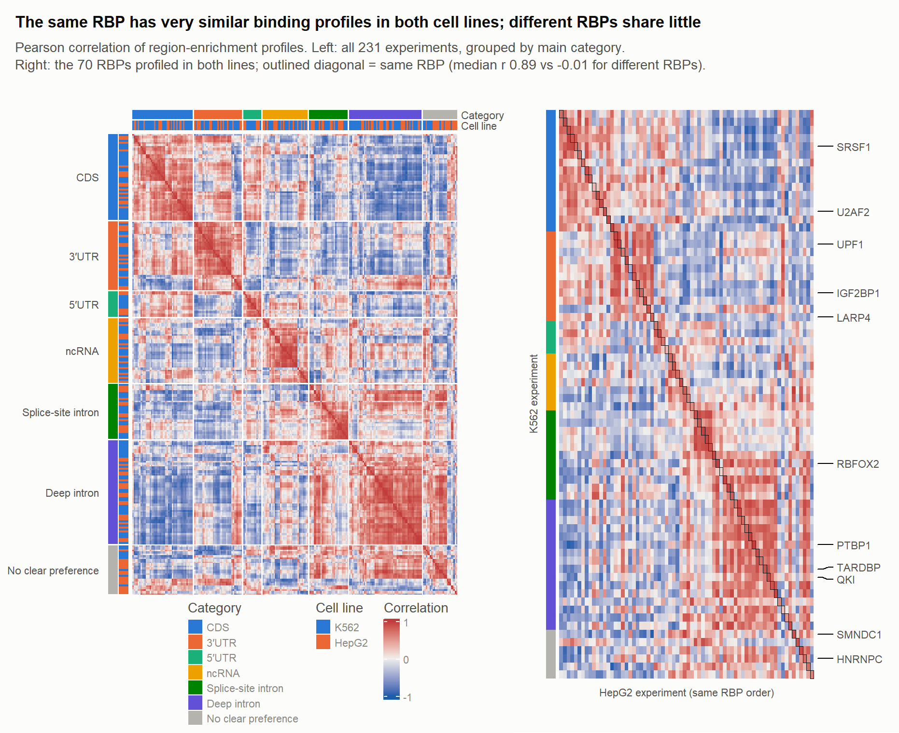

# ENCODE eCLIP Atlas

**Where do RNA-binding proteins bind on their RNA targets?** An end-to-end analysis of **250 public ENCODE eCLIP experiments** (168 RNA-binding proteins, two human cell lines), built in R and Python. It runs from automated, checksum-verified data download through genomic annotation to statistical analysis and a reproducible report.

**Report website: [victortong7.github.io/encode-eclip-atlas](https://victortong7.github.io/encode-eclip-atlas/)**



## Key findings

- **Most RBPs have a clear main binding region.** All 935,151 binding sites were assigned to transcript regions. 206 of 231 experiments favour one region (splice-site or deep intron, coding sequence, 3′UTR, 5′UTR or small non-coding RNA), and proteins with known roles land where expected.
- **Binding is a property of the protein, not the cell.** The same protein binds the same sites, genes and positions in two different cell types far more than different proteins do (median binding-profile correlation 0.89, against about 0 for different proteins). Most differences are explained by which genes each cell expresses.
- **eCLIP detection follows expression.** The number of proteins found on a gene tracks its expression (Spearman ρ ≈ 0.70) more than its length, so any comparison of bound and unbound genes needs expression matching.
- **Experiment depth is the main technical variable.** It ranges from 9 to 32,718 binding sites per experiment and differs between ENCODE phases, so comparisons are depth-matched.

## What this project demonstrates

- **Data engineering:** a resumable, rate-limited, MD5-verified download of 902 files (5.6 GB) from the ENCODE API; genome liftover (GRCh38 → hg19) with explicit filters.
- **Genomics:** transcript-region annotation with Bioconductor (GenomicRanges, GenomicFeatures); strand-aware peak assignment; expression-aware comparisons.
- **Statistics:** depth-matched overlap metrics, permutation tests, PCA, explicit baselines (two experiments of the same protein as a ceiling, different proteins as a null), and checks that changed conclusions (documented on the Methods page).
- **Quality control:** automated consistency checks on every pre-processing output, including biological spot-checks (known proteins must bind where expected).
- **Communication:** a Quarto website with question-led figures, paper-style legends and numbers computed from saved results; figures follow one validated, colour-blind-safe palette.

## Repository map

| Path | Contents |
|---|---|
| `preprocess/` | Download, liftover, region annotation, peak annotation, and consistency checks (`checks/`). See [`preprocess/README.md`](preprocess/README.md) for the peak filters used |
| `analysis/R/` | Analyses: dataset overview, binding landscape, cell-line comparison; shared plot styling in `lib_plot.R` |
| `analysis/results/` | Result tables (TSV) and figures (PNG) |
| `analysis/index.qmd`, `analysis/report/` | Website source (Quarto) |

Further analyses (sequence preferences, binding vs RNA-level change, scoring individual binding sites) are in progress and will be added when complete.

## Reproduce

1. **Install:** R 4.6 + Bioconductor 3.23 (`Rscript preprocess/R/00_install_packages.R`), Python 3 (`pip install -r requirements.txt`), Quarto ≥ 1.4.
2. **Run from the repository root, in order** (about 30 minutes; the download needs about 6 GB of disk):
   ```bash
   python -I preprocess/python/01_build_manifest.py
   python -I preprocess/python/02_download.py
   Rscript preprocess/R/02b_liftover_peaks.R
   Rscript preprocess/R/03_build_annotation.R
   Rscript preprocess/R/04_annotate_peaks.R
   python -I preprocess/python/05a_experiment_meta.py
   python -I preprocess/checks/check_preprocess.py && Rscript preprocess/checks/check_annotation.R
   Rscript analysis/R/05_dataset_overview.R      && Rscript analysis/R/05_dataset_overview_figures.R
   Rscript analysis/R/05_binding_landscape.R     && Rscript analysis/R/05_binding_landscape_figures.R
   Rscript analysis/R/05b_cross_cell_binding.R   && Rscript analysis/R/05c_cross_cell_figures.R
   ```
3. **Build the website:** `quarto render analysis` (or `quarto preview analysis`). It needs only the committed tables and figures.

## Data and licence

All data are public [ENCODE](https://www.encodeproject.org) files (eCLIP, RNA-seq, RNA Bind-n-Seq; hg19 / GENCODE V19), used under ENCODE's data-use terms; they are downloaded by the scripts, not stored here. Code is released under the [MIT licence](LICENSE).
